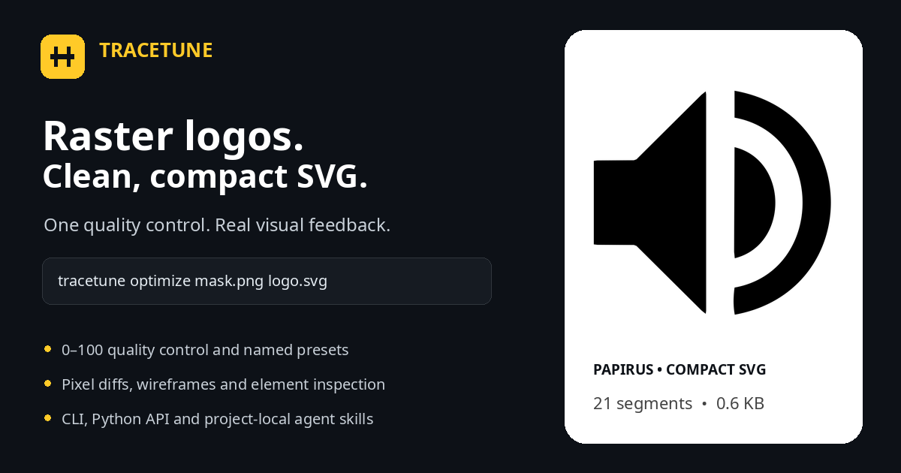
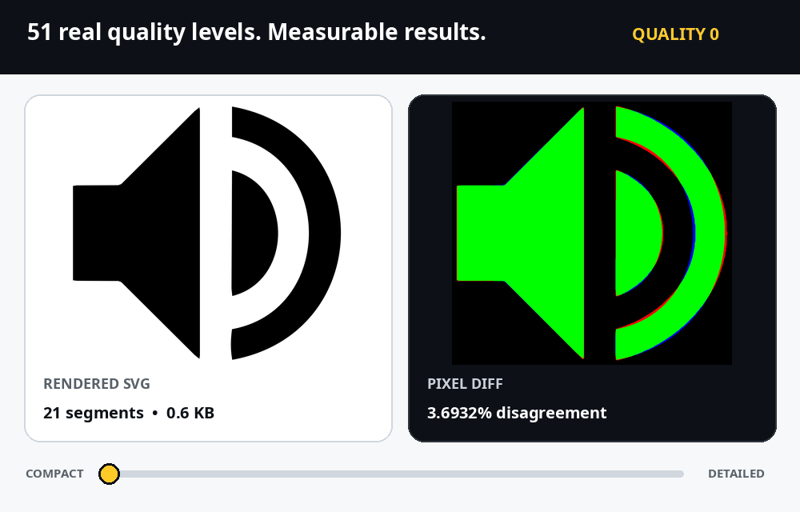
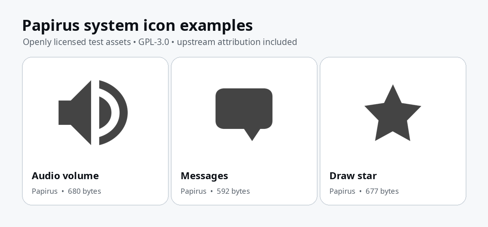

# TraceTune

[](https://github.com/PiRifle/tracetune/actions/workflows/smoke.yml)

Convert high-contrast raster logos into compact SVG paths, then inspect the result with pixel diffs, Bézier wireframes, parameter sweeps, and zoomed comparisons.

The fitter detects straight sections and sharp corners, smooths curved runs, and recursively fits cubic Bézier curves until they meet a configurable error tolerance. It supports multiple contours and holes through SVG's `evenodd` fill rule.



## Requirements

- Python 3.10 or newer
- `rsvg-convert` for the `optimize`, `diff`, and `sweep` commands (not needed to prepare masks, fit SVGs, or inspect elements)

Install the renderer with your system package manager:

```sh
# Debian / Ubuntu
sudo apt install librsvg2-bin

# Fedora
sudo dnf install librsvg2-tools

# macOS with Homebrew
brew install librsvg
```

## Install

```sh
git clone https://github.com/PiRifle/tracetune.git
cd tracetune
python3 -m venv .venv
source .venv/bin/activate
python -m pip install .
tracetune --help
```

For local development, use `python -m pip install -e .` so source changes take effect immediately. On Windows, activate the virtual environment with `.venv\Scripts\activate` instead.

## Quick start

```sh
# 1. Threshold, tightly crop, upscale, and smooth the source.
tracetune prepare input.png outputs/mask.png

# 2. Use balanced optimization; this also writes a render and pixel diff.
tracetune optimize outputs/mask.png outputs/logo.svg

# 3. Look up the SVG's elements, colors, and path complexity.
tracetune inspect outputs/logo.svg

# 4. Inspect anchors and Bézier handles.
tracetune wireframe outputs/logo.svg outputs/wireframe.png
```

`prepare` expects a light logo on a dark background. Add `--invert` for a dark logo on a light background. The resulting mask must have white foreground and a black background.

Try the included example without a source image:

```sh
tracetune optimize examples/mask.png outputs/optimized.svg --quality 0
tracetune inspect outputs/optimized.svg
tracetune wireframe outputs/optimized.svg outputs/optimized-wireframe.png
```

The already-fitted vector is available at `examples/optimized.svg`.

## Commands

| Command | Purpose |
| --- | --- |
| `prepare INPUT OUTPUT` | Create a smoothed binary mask from a raster image |
| `optimize MASK OUTPUT` | Fit, render, and evaluate an SVG with a preset or quality value |
| `presets` | Show the optimization preset lookup table |
| `inspect SVG` | List SVG elements, colors, subpaths, and path-command counts |
| `fit MASK OUTPUT` | Write an SVG with advanced parameter flags and metadata |
| `diff MASK SVG OUTPUT` | Measure pixel disagreement and create a color-coded diff |
| `wireframe SVG OUTPUT` | Draw path anchors, control points, and handles |
| `sweep MASK SPEC OUTPUT_DIR` | Evaluate several parameter sets and build a comparison sheet |
| `zoom CANDIDATE_DIR OUTPUT X Y W H NAMES...` | Compare the same crop across sweep candidates |

Run `tracetune COMMAND --help` for every option. The CLI is also available as `python -m tracetune`.

## Easy optimization and element lookup

`--quality` is the terminal equivalent of a single optimization slider: **0** produces the most compact preset, **65** is balanced, and **100** retains the most detail. Intermediate values interpolate smoothly between the presets.



```sh
tracetune optimize mask.png logo.svg                  # balanced, no options needed
tracetune optimize mask.png logo.svg --quality 85     # higher fidelity
tracetune optimize mask.png logo.svg --preset compact # smallest of the three presets
tracetune presets                                    # look up exact values
tracetune inspect logo.svg                           # inspect the result
```

| Preset | Quality | `tol` | `line_tol` | `smooth_sigma` | Best for |
| --- | ---: | ---: | ---: | ---: | --- |
| `compact` | 0 | 11 | 2.5 | 10 | Fewer segments and smaller files |
| `balanced` | 65 | 4 | 1.8 | 7 | Most logos and general use |
| `detailed` | 100 | 1.5 | 1.2 | 4 | Fine curves and maximum fidelity |

Every `optimize` run writes four files: the SVG, `.meta.json`, rendered `.png`, and `.diff.png`. Use `--render` or `--diff` to override their paths, and `--min-area` to filter tiny contours. Like `diff` and `sweep`, optimization requires `rsvg-convert`.

`inspect` provides the element lookup without a graphical interface. It reports each drawing element's type, fill, stroke, width, fill rule, subpaths, and path commands, plus file size, colors, title, viewBox, and whether raster data is embedded.

## Tune the fit

All geometric tolerances use pixels in the prepared mask, not the original source image.

| Option | Default | Effect |
| --- | ---: | --- |
| `--tol` | `1.5` | Maximum cubic deviation; lower values retain more detail and create more segments |
| `--line-tol` | `1.2` | Maximum deviation for a run to become a straight line |
| `--sigma` | `4` | Gaussian smoothing along curved runs; higher values remove small irregularities |
| `--min-area` | `600` | Ignore contours smaller than this area |

Start with the defaults, then increase `--tol` and `--sigma` for a smaller SVG. Use `diff` to check that simplification has not removed important features.

Diff images use **green** for matching foreground, **red** for mask pixels missing from the SVG, and **blue** for extra SVG pixels. The reported disagreement percentage is relative to mask foreground area.

## Parameter sweeps

A sweep specification is a JSON object mapping unique candidate names to fit parameters:

```json
{
  "detailed": {"TOL": 1.5, "LINE_TOL": 1.2, "SMOOTH_SIGMA": 4},
  "compact": {"TOL": 11, "LINE_TOL": 2.5, "SMOOTH_SIGMA": 10}
}
```

Run the included three-candidate example:

```sh
tracetune sweep examples/mask.png examples/sweep.json outputs/candidates \
  --round-name tuning
```

Each candidate produces an SVG, metadata, full-resolution render, preview, and diff. The directory also contains `results.json` and, for two or more candidates, `compare_tuning.png`.

Compare a detail at full resolution:

```sh
tracetune zoom outputs/candidates outputs/crown-zoom.png \
  850 0 500 500 detailed compact --scale 2
```

Sweep parameters accept the original uppercase names shown above or their Python field names: `tol`, `line_tol`, `smooth_sigma`, `corner_scales`, `nms_radius`, `thin_eps`, `min_area`, `reparam_iters`, `max_depth`, `min_run`, `run_sigma_factor`, and `junction_snap`. Every candidate starts from the defaults; values never leak from the preceding candidate.

## Python API

```python
from tracetune import inspect_svg, optimize_mask, prepare_mask

prepare_mask("input.png", "outputs/mask.png", invert=True)
result = optimize_mask("outputs/mask.png", "outputs/logo.svg", quality=75)

print(result["comparison"]["disagreement_pct"])
print(inspect_svg("outputs/logo.svg")["summary"])
```

For direct control, use `FitParameters` with `vectorize_mask`, followed by `compare_svg`. `vectorize_mask` accepts a parameter dictionary through `params`, using the same names as sweep files. Output parent directories are created automatically.

## System icon examples

Unmodified [Papirus](https://github.com/PapirusDevelopmentTeam/papirus-icon-theme) system icons provide repeatable, openly licensed test assets:



- [Audio volume](examples/papirus/audio-volume-high.svg)
- [Messages](examples/papirus/dialog-messages.svg)
- [Draw star](examples/papirus/draw-star.svg)

The example mask, optimized SVG, documentation pictures, and GIF are derived from these system icons. See [Papirus attribution and licensing](examples/papirus/README.md).

## Repository layout

```text
src/tracetune/   Installable library and CLI
examples/           Papirus icons, reusable mask, fitted SVG, and sweep specification
docs/assets/        README pictures and animated optimization comparison
.agents/skills/     Project-local skills for extraction and SVG optimization
outputs/            Local generated files (ignored by Git)
pyproject.toml      Package metadata and dependencies
```

## Agent skills

Agents that support project-local Agent Skills can use the workflows in `.agents/skills/`:

- [`tracetune`](.agents/skills/tracetune/SKILL.md): easy quality controls, preset and element lookups, installation, mask preparation, multicolor layers, advanced tuning, and verification.
- [`svg-icon-optimization`](.agents/skills/svg-icon-optimization/SKILL.md): geometric recreation, path simplification, accessibility, and render-based visual review.

For an agent with a separate skill directory, copy or symlink these skill directories into its supported skills location.

## Limitations

- This is a silhouette vectorizer, not a full-color or multi-layer image tracer.
- Large, detailed masks can take time because contour fitting measures two-way curve error densely.
- `wireframe` intentionally supports the absolute `M`, `L`, `C`, and `Z` commands emitted by `fit`; it is not a general SVG path visualizer.
- Raster rendering for `optimize`, `diff`, and `sweep` requires the external `rsvg-convert` executable.

## Contributing

Keep user-created renders and candidate files in `outputs/`. Before submitting a change, install the package in a clean virtual environment and exercise the affected command with `examples/mask.png` or a small synthetic image.

## License

Project code is MIT-licensed; see [LICENSE](LICENSE). The unmodified Papirus icons and derived demonstration assets are GPL-3.0; see [their attribution and license](examples/papirus/README.md).
